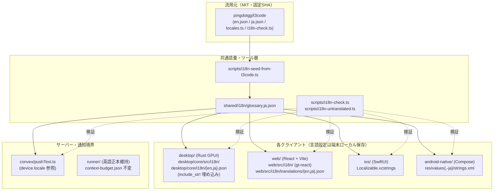

# Threadbear 日本語化（i18n / l10n）移植・実装計画

> **位置づけ**: [内蔵ブラウザとページ指摘の設計](thread:671b7c80-3c0e-4a28-8554-c072b79fb3ba)（`docs/browser-panel-plan.md`）および [Threadbear bot design](thread:ab4e9bb5-ef07-4e99-9399-c2ad1ced5fdb)（`threadbear-native-bot-port-plan.md`）と同じく、手元の Threadbear フォーク（`/Users/ryryo/threadbear`）の本体カスタマイズとして実装し、通常チェックと `tb land` を経て反映するための全段階計画書。
>
> **基本方針**: 車輪の再開発を避け、MIT ライセンスの [`pingdotgg/t3code`](https://github.com/pingdotgg/t3code) で実績のある **i18n 方式（ソース英語キー・オフライン JSON カタログ・`$context` 訳し分け・未翻訳リント・CI ドリフト検査）** と **日本語翻訳資産（17,898 語の対訳・UI 語彙・トーン）** を積極的に流用・移植する。
>
> **実装着手時の配置先**: 本計画書は着手前の正本として `/Users/ryryo/ThreadbearThreads/threadbear-japanese-localization-plan.md` に保存し、専用 worktree 作成時にリポジトリ内 `docs/japanese-localization-plan.md` へコミットする。

---

## 0. 基準リポジトリ・固定リビジョン・ライセンス確認

実装時に参照する原典とライセンスを以下の通り固定する。

| 対象 | リポジトリ / パス | 固定 commit SHA | ライセンス | 用途 |
| --- | --- | --- | --- | --- |
| Threadbear（作業先フォーク） | `/Users/ryryo/threadbear`（`mikecann/threadbear` フォーク） | `471d25f7c3d6743eb49219bcbbdba76633eed91a`（`main` 基準） | MIT | 日本語化の対象本体 |
| T3 Code（流用元） | [`pingdotgg/t3code`](https://github.com/pingdotgg/t3code) | `ae945dd42a9879104991280df99182a0f0cec3bf` | **MIT**（`Copyright (c) 2026 T3 Tools Inc.`） | i18n ランタイム・ロケール解決・検証スクリプト・未翻訳リント・日本語カタログ語彙の流用元 |
| 並行作業 1（内蔵ブラウザ） | `/Users/ryryo/threadbear-threads/slot-1` | `00c8502c`（進行中） | MIT | ブラウザパネル新規 UI 文字列の取り込み連携・`docs/third-party/t3-code-MIT.txt` 共有 |
| 並行作業 2（専用 Bot） | `/Users/ryryo/threadbear-threads/slot-2` | `243c4827`（進行中） | MIT / Apache-2.0 | Bot 画面新規 UI 文字列の取り込み連携 |

### ライセンス・出典保全の約束

- `pingdotgg/t3code` の `LICENSE` 原文が MIT であることを確認済み（`Copyright (c) 2026 T3 Tools Inc.`）。
- `slot-1` の内蔵ブラウザ改修ですでに `docs/third-party/t3-code-MIT.txt` を配置しているため、日本語化でも**同一のライセンス通知ファイルを共有**し、重複ファイルを作らない。
- `third_party/t3code/manifest.json` に、流用したファイル・固定 SHA・元パス・blob ハッシュ・分類（A/B/C）・移植先・変更理由を記録する。
- `gt-react` / `gt-i18n` / `gt` CLI は **オフライン抽出・ローカル JSON カタログ読み込みのみ**で使用し、GT Cloud（外部翻訳 API・クラウド鍵）には一切依存しない（T3 Code `docs/internals/14_i18n.md` と同一方針）。

---

## 1. スコープとサーフェス棚卸し

Threadbear リポジトリ（`471d25f7`）の全 UI サーフェスを実測し、優先順と対象範囲を確定する。

| サーフェス | 技術スタック | 規模（実測） | 現状の i18n | 計画での扱い |
| --- | --- | --- | --- | --- |
| **`desktop/`（主対象）** | Rust + GPUI (`desktop/core`, `desktop/gpui`, `desktop/dock`, `desktop/web`) | `gpui`: 170 files / 142,917 行（候補リテラル 5,706〜7,991 件） `core`: `sidebar.rs`, `inbox.rs`, `reducer/`, `runner_settings.rs`, `usage.rs`, `updates.rs` 等 | なし（英語ハードコード） | **最優先（P1〜P3）**。普段使いの macOS デスクトップアプリ本体 |
| **`web/`** | React 19.3 + Vite 8.3 + TypeScript 7.0 | 6,823 行（テスト除く） | なし（英語ハードコード） | **高優先（P4）**。T3 Code の `gt-react` 構成を最小差分で直接移植 |
| **`convex/`・`runner/`** | TypeScript（Convex / Node） | `convex/pushText.ts`、エラー・状態通知 | なし | **中優先（P5）**。Push 通知の多言語化と、サーバー英語維持＋クライアント翻訳境界の確定 |
| **`ios/`** | SwiftUI (`Threadbear`, `ThreadbearKit`, `NotificationService`) | 190 files / 34,847 行 | `.xcstrings` / `.lproj` なし | **中優先（P6）**。Xcode String Catalog (`Localizable.xcstrings`) 導入＋語彙共有 |
| **`android-native/`** | Kotlin + Jetpack Compose (`app`, `kit`) | 148 files / 24,130 行 | `strings.xml` なし | **中優先（P7）**。`res/values{,-ja}/strings.xml`＋Per-App Language 対応 |
| **`site/`** | 静的サイト / Worker | マーケティング・ドキュメント | なし | **任意最終段階（P8）**。T3 Code `apps/marketing/src/i18n` 方式の適用手順を明記 |
| **`app/`・`dock/`（旧 Swift Mac 版）** | Swift / AppKit | 凍結済み（`scripts/swift-freeze.sh`） | — | **対象外**（`AGENTS.md` の GPUI 移行方針に従い変更禁止） |

> **実測による T3 Code 語彙の即効性**: `t3code` の `apps/web` + `apps/desktop` の `en.json`↔`ja.json` には **17,898 件** のユニーク対訳が存在する。単純な完全一致（大文字小文字区別）だけでも、Threadbear `desktop/gpui/src`・`desktop/core/src` の候補リテラルに対して **642 件** が即座に一致した（例: `Appearance => 外観`, `Archive => アーカイブ`, `Browser => ブラウザー`, `Actual Size => 実際のサイズ`, `Bring All to Front => すべてを手前に移動`, `Changes requested => 変更をリクエスト`）。さらに `T3 Code`→`Threadbear` の製品名置換や正規化マッチを加えることで、大半の共通 UI・設定・メニュー・エラー文言を統一語彙で自動シードできる。

---

## 2. T3 Code 流用マップ（分類 A / B / C / D）

[Threadbear bot design](thread:ab4e9bb5-ef07-4e99-9399-c2ad1ced5fdb) と同じ分類基準で、原典流用と既存 Threadbear 契約への接続を明確に切り分ける。

- **A（直接コピー）**: ロジック・テストをほぼ無変更で取り込む
- **B（コピー＋最小調整）**: 原典コード・アルゴリズム・構造をコピーし、Threadbear の設定保存先・言語（Rust/ESLint）・パスに合わせて最小調整する
- **C（既存 Threadbear 契約へ接続）**: 新規に再実装せず、Threadbear に既存の機構を使う
- **D（新規設計）**: Threadbear 固有要件（GPUI Rust マクロ、macOS `Info.plist`、Convex Push の `locale` 等）

### 2.1 コンポーネント別マッピング

| 責務 | 分類 | 原典 / 参照先（固定 SHA） | Threadbear での移植先・調整内容 |
| --- | --- | --- | --- |
| **ロケール解決・自言語名表示** (`SYSTEM_LANGUAGE`, `nativeLanguageName`, `resolveLocale`, `resolveLocaleSelection`, 繁体字分岐) | **A / B** | [`packages/client-runtime/src/locales.ts`](https://github.com/pingdotgg/t3code/blob/ae945dd42a9879104991280df99182a0f0cec3bf/packages/client-runtime/src/locales.ts#L1-L56) [`apps/web/src/i18n/locales.test.ts`](https://github.com/pingdotgg/t3code/blob/ae945dd42a9879104991280df99182a0f0cec3bf/apps/web/src/i18n/locales.test.ts) | `web/src/i18n/locales.ts` へ **A コピー**（対応ロケールを `["en", "ja"]` に絞る）。同一アルゴリズムとテストケースを `desktop/core/src/i18n/locale.rs` へ **B 移植**。 |
| **Web i18n ランタイム** (`I18nProvider`, `initializeI18n`, `runtime.ts`, `messages.ts`, `gt.config.json`) | **B** | [`apps/web/src/i18n/I18nProvider.tsx`](https://github.com/pingdotgg/t3code/blob/ae945dd42a9879104991280df99182a0f0cec3bf/apps/web/src/i18n/I18nProvider.tsx#L1-L20) [`apps/web/src/i18n/runtime.ts`](https://github.com/pingdotgg/t3code/blob/ae945dd42a9879104991280df99182a0f0cec3bf/apps/web/src/i18n/runtime.ts#L1-L104) [`apps/web/src/i18n/messages.ts`](https://github.com/pingdotgg/t3code/blob/ae945dd42a9879104991280df99182a0f0cec3bf/apps/web/src/i18n/messages.ts#L1-L40) | `web/src/i18n/` へコピー。設定読み書きフックを `useSettings` から Threadbear の `web/src/language.ts`（`web/src/theme.ts` と同型の `localStorage` 管理）へ差し替え。`gt-react` + `gt-i18n` + `gt`（オフライン生成）を採用。 |
| **翻訳可能エラー型** (`MarkedText`, `translatableError`, `errorDisplayMessage`) | **A / B** | [`packages/client-runtime/src/errors/translatable.ts`](https://github.com/pingdotgg/t3code/blob/ae945dd42a9879104991280df99182a0f0cec3bf/packages/client-runtime/src/errors/translatable.ts#L1-L116) | `web/src/i18n/translatable.ts` へコピー。`effect/Schema` 依存のみ外し、素の TypeScript 型＋テスト (`translatable.test.ts`) を維持。 |
| **ブラウザ自動翻訳ガード**（Google 翻訳拡張による React DOM 破損防止） | **A** | [`apps/web/src/lib/pageTranslationGuard.ts`](https://github.com/pingdotgg/t3code/blob/ae945dd42a9879104991280df99182a0f0cec3bf/apps/web/src/lib/pageTranslationGuard.ts) | `web/src/lib/pageTranslationGuard.ts` へ直接コピーし、`web/src/main.tsx` で有効化。 |
| **デスクトップ翻訳解決エンジン**（英語ゼロロード・未翻訳フォールバック・文字列変数・`onLocaleChange`） | **B** | [`apps/desktop/src/i18n/messages.ts`](https://github.com/pingdotgg/t3code/blob/ae945dd42a9879104991280df99182a0f0cec3bf/apps/desktop/src/i18n/messages.ts#L1-L84) [`docs/internals/14_i18n.md`](https://github.com/pingdotgg/t3code/blob/ae945dd42a9879104991280df99182a0f0cec3bf/docs/internals/14_i18n.md#L1-L47) | Rust 版 `desktop/core/src/i18n/` へ仕様を忠実移植。英語時は検索スキップ、未翻訳時は英語＋英語複数形、変数補間は数値への勝手なカンマ整形を行わない（T3 Code `messages.ts` L33–34 の PID カンマ防止ルールをそのまま踏襲）。 |
| **カタログ整合性 CI チェック** (`i18n-check.ts`) | **B** | [`scripts/i18n-check.ts`](https://github.com/pingdotgg/t3code/blob/ae945dd42a9879104991280df99182a0f0cec3bf/scripts/i18n-check.ts#L1-L87) | `scripts/i18n-check.ts` へコピーし、`web/`（GT オフライン抽出比較）に加えて `desktop/core/i18n/*.json`（Rust `tr!`/`trf!`/`trn!` 抽出比較）、`ios/`、`android-native/` のキー・プレースホルダ整合検証を同一スクリプトへ統合。 |
| **未翻訳コピー検出ルール＆集計** (`no-untranslated-copy`, `i18n-untranslated.ts`) | **B** | [`oxlint-plugin-t3code/rules/no-untranslated-copy.ts`](https://github.com/pingdotgg/t3code/blob/ae945dd42a9879104991280df99182a0f0cec3bf/oxlint-plugin-t3code/rules/no-untranslated-copy.ts) [`scripts/i18n-untranslated.ts`](https://github.com/pingdotgg/t3code/blob/ae945dd42a9879104991280df99182a0f0cec3bf/scripts/i18n-untranslated.ts#L1-L42) | Threadbear は ESLint 10（`eslint.config.mjs`）を採用しているため、`no-untranslated-copy` の `COPY_NAMES`・`COPY_ATTRIBUTES`・`COPY_CALLS` 判定ロジックをそのまま ESLint カスタムルール（`web/` 向け）へ移植。Rust 向けにも `scripts/i18n-untranslated.ts` に `.tip(...)` / `TopMenu::new` / `.label(...)` 等の未ラップ監査モードを追加。 |
| **日本語翻訳カタログ＆メニュー語彙** | **A（シード）** | [`apps/desktop/src/i18n/translations/{en,ja}.json`](https://github.com/pingdotgg/t3code/blob/ae945dd42a9879104991280df99182a0f0cec3bf/apps/desktop/src/i18n/translations/ja.json) [`apps/web/src/i18n/translations/{en,ja}.json`](https://github.com/pingdotgg/t3code/blob/ae945dd42a9879104991280df99182a0f0cec3bf/apps/web/src/i18n/translations/ja.json) [`apps/mobile/src/i18n/translations/{en,ja}.json`](https://github.com/pingdotgg/t3code/blob/ae945dd42a9879104991280df99182a0f0cec3bf/apps/mobile/src/i18n/translations/ja.json) | `scripts/i18n-seed-from-t3code.ts` で自動引き当てし、`shared/i18n/glossary.ja.json` および各アプリ `ja.json` の初期訳を生成。macOS 標準メニュー（ファイル・編集・表示・ウインドウ・ヘルプ）は T3 Code `apps/desktop/src/i18n/translations/ja.json` を直接採用。 |
| **GPUI 設定永続化** (`desktop-settings.json`) | **C** | 既存 `desktop/gpui/src/settings.rs` (`Saved` + `#[serde(flatten)] extra`) | `Saved` に `pub language: Option<String>` を追加するのみ。旧ビルドへロールバックしても `extra` に保持され破壊しない。 |
| **GPUI 再起動不要の即時再描画** | **C** | 既存 `desktop/gpui/src/style.rs` (`LOOK`, `bump_look()`, `layout_key()`) 既存 `desktop/gpui/src/shell.rs` (`cx.set_menus`) | 言語変更時に `style::bump_look()` を呼び、キャッシュ済み `SidebarView`・行高・読み取りスタイルを一括破棄し、`cx.set_menus` 再構築＋全ウィンドウ `cx.notify()` で即時反映。独自の再描画仕組みは作らない。 |
| **GPUI ツールチップ契約** | **C** | 既存 `desktop/gpui/src/tips.rs` (`Tip::tip`) 既存 `desktop/core/tests/tips_source.rs` | すべてのツールチップは引き続き `.tip(...)` 経由。`tips_source.rs` を維持したまま翻訳を適用。 |
| **Web 設定永続化** | **C** | 既存 `web/src/theme.ts` (`localStorage`, 起動前適用) | 同じパターンで `web/src/language.ts`（`threadbear.language`）を実装し、`main.tsx` で初回描画前に起動。 |

### 2.2 原典（T3 Code）と意図的に互換にしない箇所

偶発的なズレではなく、Threadbear のアーキテクチャ上必要な設計差分として明示し、差分テストを伴わせる。

1. **デスクトップ本体は Electron ではなく Rust GPUI**: T3 Code の `apps/desktop` は Electron (Node) で `gt-i18n` を動的 `import` するが、Threadbear `desktop/` は Rust バイナリである。Rust 側では `include_str!` でコンパイル時に `desktop/core/i18n/ja.json` を埋め込み、起動時ファイル I/O ゼロ・オフライン完結・静的チェック可能にする。
2. **対応ロケールはまず `en` / `ja` の 2 言語に集中**: T3 Code のように 10 言語分を空維持すると保守負荷が跳ね上がるため、初期カタログは `en` と `ja` のみ。構造自体は `locales` 配列へ追加するだけで他言語へ拡張可能にする。
3. **キー形式の可読性（Rust カタログ）**: `web/` は `gt` CLI 互換のハッシュキー JSON を使うが、Rust 側 `desktop/core/i18n/ja.json` は **ソース英語文字列（`$context` あり時は `"<source>\u0004<context>"` または `{ "source", "context" }` 由来の決定的キー）** を採用する。理由: フォークで上流マージした際に `git diff` だけで未訳・変更文言が人間にもエージェントにも即読めるため。
4. **多義語 `Compact` の扱い**: T3 Code では `Compact => 圧縮`（コンテキスト圧縮の意味）だが、Threadbear の `Settings > General > Appearance > Spacing` の `Roomy` / `Compact` は密度・余白を指すため、`$context = "appearance spacing"` で **`コンパクト`** に訳し分ける。
5. **自動化・テスト実行時の既定ロケール**: macOS が日本語環境であっても、ユニットテスト・ゴールデンテスト・`THREADBEAR_AUTOMATION` 起動時は明示指定（`THREADBEAR_LANGUAGE=ja` 等）がない限り **`en` 固定**とする。これにより既存の `features/*.feature` と `desktop/core/tests/golden.rs` を一切壊さず維持する。

---

## 3. 翻訳ルール・語彙統一（T3 Code 準拠）

### 3.1 文字列記述ルール（`t3code/docs/internals/14_i18n.md` 準拠）

1. **文を分割しない**: 1 文＝1 エントリとし、変数を埋め込む。翻訳断片の文字列結合（`tr!("Delete ") + name` 等）は禁止。
2. **変数は名前付き・英語テキスト無変更**:
   - Web: `gt("{shortcut} to undo", { shortcut })` / `<T>…</T>` + `<Var>` / `<Plural>`
   - Rust: `trf!("{shortcut} to undo", shortcut = sc)` / `trn!("{count} thread", "{count} threads", count)`
   - 数値変数はそのまま整数文字列として埋め込み、ID・PID・ポート番号にロケール由来のカンマ（`12,345`）が入らないようにする。
3. **`$context` による曖昧さ解消**: 品詞や文脈で訳が変わる 1〜2 語ラベルは必ずコンテキストを付ける（例: `Open` の動詞「開く」vs PR 状態「オープン」）。
4. **英語のまま保持するもの（翻訳禁止リスト）**:
   - プロダクト・サービス・OS 名: `Threadbear`, `BrowserBear`, `Pocket`, `Quick Ask`, `Claude`, `Codex`, `Gemini`, `GitHub`, `Convex`, `macOS`, `Finder`, `Chrome`, `Allo`（フォント名）
   - モデル ID・CLI コマンド・ファイルパス・URL・コードスニペット・正規表現
   - キーボードショートカット表記（`⌘K`, `⇧⌘Z`, `Ctrl+K` 等）
   - ユーザーの会話本文、スレッドタイトル、エージェントの応答
   - **エージェントへ渡すシステム指示・MCP ツール説明**（`runner/context-budget.json` のバイト予算に影響させない）
   - 内部プロトコル値・永続化キー（`InboxOrder::raw`, `Tab::name`, `Font::name`, `desktop-settings.json` のキー名）
   - デバッグログ・コンソール出力
5. **トーン＆表記統一（T3 Code `ja.json` 準拠）**:
   - ボタン・メニュー・見出し・タブ: 簡潔な体言止め／動詞基本形（例: `保存`, `キャンセル`, `スレッドをアーカイブ`, `リンクをコピー`）
   - 確認ダイアログ・説明文・エラー・空状態: 丁寧な「です・ます」調（例: `この操作は元に戻せません。`, `更新を確認できませんでした。`）
   - カタカナ長音: T3 Code `ja.json` に合わせ **`ブラウザー`・`フォルダー`・`フィルター`・`サーバー`・`プロバイダー`・`ランナー`** で統一（CI の用語チェックで揺れを検出）
   - 半角英数字と日本語の間は T3 Code 同様に半角スペースを 1 つ入れる（例: `Threadbear を終了`, `Finder で表示`, `{host} は接続されていません。`）
   - Threadbear UI 規約（`AGENTS.md`）に従い、平易な言葉を使い、キッカーラベルや em dash（`—`）を使わない

### 3.2 T3 Code から継承する中核語彙（抜粋）

`t3code` の `ja.json` からそのまま継承し、`shared/i18n/glossary.ja.json` に登録する代表語彙。

| 英語 | 日本語（T3 Code 準拠） | 出典 |
| --- | --- | --- |
| Thread / Threads / New thread | スレッド / スレッド / 新しいスレッド | `t3code` web `ja.json` |
| Project / Projects / Add project | プロジェクト / プロジェクト / プロジェクトを追加 | `t3code` web `ja.json` |
| Archive / Archive thread / Unarchive / Archived | アーカイブ / スレッドをアーカイブ / アーカイブを解除 / アーカイブ済み | `t3code` web `ja.json` |
| Draft / Discard draft | 下書き / 下書きを破棄 | `t3code` web `ja.json` |
| Queue / Queued | キュー / 待機中（文脈により キュー内） | `t3code` web `ja.json` |
| Worktree / Branch / Commit / Diff | ワークツリー / ブランチ / コミット / 差分 | `t3code` web `ja.json` |
| Send / Stop / Interrupt / Cancel / Retry | 送信 / 停止 / 中断 / キャンセル / 再試行 | `t3code` web `ja.json` |
| Edit / Delete / Rename / Copy / Paste | 編集 / 削除 / 名前を変更 / コピー / 貼り付け（メニューでは ペースト） | `t3code` web / desktop `ja.json` |
| Settings / General / Appearance / Language | 設定 / 一般 / 外観 / 言語 | `t3code` web `ja.json` |
| Theme / Dark / Light / System / Accent | テーマ / ダーク / ライト / システム / アクセント | `t3code` web `ja.json` |
| Keyboard / Shortcuts / Keybindings | キーボード / ショートカット / キーボードショートカット | `t3code` web `ja.json` |
| Account / Sign in / Sign out | アカウント / サインイン / サインアウト | `t3code` web `ja.json` |
| Model / Models / Effort (Low / Medium / High / Max) | モデル / モデル / 推論レベル（低 / 中 / 高 / 最大） | `t3code` web `ja.json` |
| Permissions / Full access | 権限 / フルアクセス | `t3code` web `ja.json` |
| Approval / Approve / Allow / Always allow / Deny | 承認待ち / 承認 / 許可 / 常に許可 / 拒否 | `t3code` web `ja.json` |
| Terminal / Browser / Preview | ターミナル / ブラウザー / プレビュー | `t3code` web `ja.json` |
| Pin / Unpin / Pinned | ピン留め / ピン留めを解除 / ピン留め済み | `t3code` web `ja.json` |
| Schedule / Running / Idle / Waiting / Done / Failed | スケジュール / 実行中 / アイドル / 待機中 / 完了 / 失敗 | `t3code` web `ja.json` |
| Usage / Tokens / Context / Memory | 使用量 / トークン / コンテキスト / メモリ | `t3code` web `ja.json` |
| Connected / Offline / Reconnecting / Update / Restart | 接続済み / オフライン / 再接続中 / 更新 / 再起動 | `t3code` web `ja.json` |
| just now / `{count}m ago` / `{count}h ago` / `{count}d ago` | たった今 / `{count}分前` / `{count}時間前` / `{count}日前` | `t3code` web `ja.json` |
| File / Edit / View / Window / Help（macOS メニュー） | ファイル / 編集 / 表示 / ウインドウ / ヘルプ | `t3code` desktop `ja.json` |
| About / Check for Updates... / Settings... / Hide / Quit | `{appName} について` / 更新を確認... / 設定... / `{appName} を隠す` / `{appName} を終了` | `t3code` desktop `ja.json` |
| Undo / Redo / Cut / Copy / Paste / Select All | 取り消す / やり直す / カット / コピー / ペースト / すべてを選択 | `t3code` desktop `ja.json` |
| Minimize / Zoom / Bring All to Front / Actual Size / Zoom In / Zoom Out | しまう / 拡大/縮小 / すべてを手前に移動 / 実際のサイズ / 拡大 / 縮小 | `t3code` desktop `ja.json` |
| Reveal in Finder / Copy Link / Open in browser | Finder で表示 / リンクをコピー / ブラウザーで開く | `t3code` desktop / web `ja.json` |

### 3.3 `$context` 訳し分け必須の多義語表

| 英語 | `$context` | 日本語 | 使い分け対象 |
| --- | --- | --- | --- |
| `Open` | `verb, opens an item` | 開く | ファイル・リンク・パネルを開く |
| `Open` | `pull request state` | オープン | PR 状態バッジ |
| `Close` | `verb, closes a window or panel` | 閉じる | ウィンドウ・シート・パネル |
| `Close` | `pull request state` | クローズ | PR 状態 |
| `Compact` | `appearance spacing` | コンパクト | Settings > General > Appearance の余白 |
| `Compact` | `context compaction` | 圧縮 | コンテキスト圧縮・ツール名 |
| `Clear` | `verb, removes search or list` | クリア | 検索欄・フィルター消去 |
| `Review` | `verb, inspect options or PR` | レビュー / 確認 | 選択肢レビュー画面は「レビュー」、確認操作は「確認」 |
| `Share` | `verb, share thread or link` | 共有 | スレッド共有ボタン |
| `Share` | `noun, usage proportion` | 割合 | 使用量グラフの内訳 |

### 3.4 Threadbear 固有概念の確定訳語表

T3 Code に存在しない Threadbear 独自概念の訳語を事前に固定し、画面間の表記揺れを防ぐ。

| 英語（Threadbear 固有） | 日本語確定訳 | 備考 |
| --- | --- | --- |
| Inbox | 受信トレイ | サイドバー中核セクション |
| Starred / Star: keep at the top / Remove star | スター付き / スターを付けて上部に固定 / スターを外す | `desktop/core/src/sidebar.rs` |
| Needs you / Needs you first | 確認が必要 / 確認が必要を先頭に | ソート順・バッジ |
| Newest first / Oldest first | 新しい順 / 古い順 | `InboxOrder` |
| Hibernate / Hibernating / Wake | 休止 / 休止中 / 再開（メニュー文脈では 休止を解除） | Threadbear 独自の Snooze 表現 |
| Highlights | ハイライト | ピン留め一覧のサイドパネル |
| Pocket | Pocket | 固有名詞として維持（説明文のみ日本語化） |
| Coordinators | コーディネーター | サイドバーセクション |
| Librarian | ライブラリアン | スレッド自動分類・整理機能 |
| Recipes | レシピ | 再利用テンプレート |
| Scheduled | スケジュール済み（タブ見出しは スケジュール） | `SidebarMode::Scheduled` |
| Runners / Pools / Connectors / Patches | ランナー / プール / コネクター / パッチ | 設定タブ・パネルタイトル |
| Phone & browser | スマホとブラウザー | `Settings > Phone & browser` (`Tab::Devices`) |
| Small jobs | 補助タスク | `settings_window/small_jobs.rs` |
| Standing instructions | 常時指示 | `runner_settings.rs` |
| Finish setting up | 初期設定を完了 | `setup_panel.rs` |
| Roomy / Compact（Spacing） | ゆったり / コンパクト | `style.rs` Appearance Spacing |
| Fur（Accent color） | ファー（または ベアカラー系は色名に合わせて統一） | `style.rs` `Accent` |
| Keep an activity log | アクティビティログを記録 | `settings.rs` `activity_log` |
| Open in Panel / Pick element / Pick region | パネルで開く / 要素を選択 / 範囲を選択 | `slot-1` 内蔵ブラウザ連携 |
| Bots / Chief / Group / Memory（Bot） | Bot / Chief / グループ / 記憶 | `slot-2` 専用 Bot 連携（`Bot` / `Chief` は固有名詞寄り維持） |

---

## 4. アーキテクチャ設計と Threadbear 固有の技術対策

### 4.1 全体構成（オフライン完結・共通語彙ソース）

### 4.2 Rust GPUI 翻訳エンジン（`desktop/core/src/i18n/`）の具体設計

1. **配置**:
   - `desktop/core/src/i18n/mod.rs`: 公開 API（`LanguageSetting`, `Locale`, `set_language`, `active_locale`, `tr`, `tr_ctx`, `tr_fmt`, `tr_plural` とマクロ `tr!`, `trf!`, `trn!`）
   - `desktop/core/src/i18n/locale.rs`: T3 Code `packages/client-runtime/src/locales.ts` の忠実移植（`resolve_locale`, `resolve_locale_selection`, `native_language_name`）
   - `desktop/core/src/i18n/catalog.rs`: `include_str!("../../i18n/ja.json")` を `OnceLock<HashMap<String, String>>` へ初回のみパース。`Locale::En` の場合はハッシュ引きせず `&'static str` / 英語文字列を即返却。
   - `desktop/core/src/i18n/format.rs`: `{name}` 名前付きプレースホルダ補間と `one` / `other` / `=1` 複数形解決（数値フォーマットはカンマ挿入しない、エスケープ `{{` / `}}` 対応）。
   - `desktop/core/src/i18n/system.rs`: OS の優先言語配列取得（macOS: `NSLocale.preferredLanguages`、Windows: `GetUserPreferredUILanguages`、Linux: `LANGUAGE` / `LC_ALL` / `LANG`）。
2. **設定保存と即時切替**:
   - `desktop/gpui/src/settings.rs` の `Saved` に `pub language: Option<String>` を追加（値: `"system"`, `"en"`, `"ja"`。`None` は `"system"` 扱い）。
   - 起動時に `settings.language` と OS 優先言語からロケールを解決し、**初回ウィンドウ描画前**に `i18n::init(...)` を完了する（Web の `applyTheme()` と同じく英語チラつきをゼロにする）。
   - 設定画面（`Settings > General > Language`）での切替時:
     1. `settings.language` を保存
     2. `i18n::set_language(...)` でグローバル `AtomicU8` を更新
     3. `style::bump_look()` を呼び、行高・サイドバーキャッシュ・読書スタイルを一括無効化
     4. `shell.rs` の `cx.set_menus(gpui_menus(...))` を再実行して macOS メニューバーを即時更新
     5. 開いている全ウィンドウ（メイン・Settings・Review 等）へ `cx.notify()` を発火
3. **テスト・自動化との分離**:
   - `#[cfg(test)]` および `THREADBEAR_AUTOMATION` 環境変数設定時は、`THREADBEAR_LANGUAGE` が明示指定されない限り既定ロケールを **`Locale::En`** に固定する。
   - `desktop/gpui/src/automation.rs` に `{"cmd": "settings", "language": "ja" | "en" | "system"}` を追加し、Cucumber シナリオから任意のタイミングで日本語・英語を切り替え検証可能にする。
4. **`tips.rs` とアクティビティログの両立**:
   - `desktop/core/tests/tips_source.rs` がすべてのツールチップに `.tip(...)` 経由を要求しており、`tips.rs` はそのテキストを `activity.rs`（クリック記録）と `simulate_press`（自動化テスト）に使う。
   - 解決策: `Tip::tip` へ渡す文言は通常通り `tr!(...)` で翻訳しつつ、必要であれば `TipText { display: SharedString, canonical: &'static str }` を受け取れるよう拡張し、`activity.rs` には英語の `canonical` を記録、ホバー表示には `display`（日本語）を描画する。これにより、日本語利用中でも `tb activity` ログとエージェント解析が英語キーで一貫する。
5. **macOS `Info.plist` と AppKit 自動メニュー**:
   - GPUI の `window_menu.rs` が示す通り、macOS では AppKit が `Edit` / `Window` / `View` メニューに「自動入力」「音声入力を開始」「絵文字と記号」「フルスクリーンにする」等を自動挿入し、またファイル選択・保存パネルを描画する。
   - アプリバンドルの `Info.plist`（`desktop/scripts/` のバンドル生成箇所）に `CFBundleLocalizations` = `["en", "ja"]` を追加し、OS 言語または `AppleLanguages` と整合させる。
   - アプリ内言語を OS と異なる設定にした場合（例: OS が英語でアプリだけ日本語、または逆）の AppKit 標準ダイアログ挙動を実機確認し、`docs/guide.md` へ明記する。
6. **日本語フォント・行高・レイアウト・IME の検証**:
   - `desktop/gpui/src/style.rs` の既定フォント `Font::Allo` はラテン専用フォント。日本語グリフが macOS でヒラギノ角ゴシック等へ正しくフォールバックし、以下が崩れないことを必須チェックにする:
     - サイドバー（`SIDEBAR_WIDTH = 215.`）でのセクション見出し・行タイトル・ホバーボタンの省略と被り
     - 設定ウィンドウのサイドバー（6 タブ）とセグメントコントロール・ドロップダウンの幅
     - `composer.rs`・検索欄・スレッド名変更欄での日本語 IME（変換中下線・確定・Enter 送信誤爆しないこと）
     - `rows/markdown.rs` での日本語見出し・太字・コード混在・URL 直後の全角文字（T3 Code Issue `#35138` の回帰教訓をテストケース化）

---

## 5. 全段階の実装計画（P0〜P8）

各段階を「実装範囲・流用元・変更ファイル・受け入れテスト・完了条件」まで省略せず定義する。

### P0: 原典固定・ライセンス保全・語彙シード・検証ツール基盤

- **目的**: T3 Code の資産を再現可能な形で固定し、全プラットフォームで共有する語彙辞書と自動検証の土台を先に作る。
- **流用元**:
  - `pingdotgg/t3code@ae945dd42a9879104991280df99182a0f0cec3bf`: `LICENSE`, `apps/{desktop,web,mobile}/src/i18n/translations/{en,ja}.json`, `scripts/i18n-check.ts`, `scripts/i18n-untranslated.ts`
- **作成・変更ファイル**:
  - `docs/third-party/t3-code-MIT.txt`（`slot-1` と同一パスを確認・共有）
  - `third_party/t3code/manifest.json`（固定 SHA・各原典ファイルのパス・ハッシュ・分類 A/B/C・移植先）
  - `shared/i18n/glossary.ja.json`（第 3 章の共通語彙＋多義語 `$context`＋Threadbear 固有語彙を機械検証可能な JSON で固定）
  - `scripts/i18n-extract-rust.ts`（`desktop/core/src`・`desktop/gpui/src`・`desktop/dock/src`・`desktop/web/src` から `tr!`/`trf!`/`trn!`/`tr_const!` を AST/正規表現で決定的に抽出し `desktop/core/i18n/en.json` を生成・`ja.json` の新規キー追加と廃止キー削除をオフライン実行）
  - `scripts/i18n-seed-from-t3code.ts`（ローカルキャッシュまたは取得済み T3 Code カタログと `glossary.ja.json` を突き合わせ、完全一致・`T3 Code`→`Threadbear` 置換一致の訳語候補を自動充填し、出典メモを出力）
  - `scripts/i18n-check.ts`（T3 Code から B 移植。`en.json` ドリフト・`ja.json` 欠落/余剰キー・プレースホルダ `{var}` 不一致・禁止表現/用語揺れを検出して非 0 終了）
  - `scripts/i18n-untranslated.ts`（ディレクトリ別の未翻訳件数レポーター）
  - `docs/japanese-localization-plan.md`（本計画書をリポジトリへ格納）
- **受け入れテスト**:
  - `node scripts/i18n-check.ts` が空カタログ状態で正常終了し、意図的にキー欠落や `{var}` 破損を入れたテストフィクスチャで確実に失敗すること。
  - `scripts/i18n-seed-from-t3code.ts` が `glossary.ja.json` と T3 Code 対訳から決定的な JSON を出力し、2 回実行して差分がゼロであること。
- **完了条件**: マニフェスト・MIT 表記・語彙辞書・抽出/検証スクリプトが単体テスト付きで動作し、本体アプリに未影響であること。

---

### P1: `desktop/core` i18n エンジン＆GPUI 設定・即時切替基盤

- **目的**: Rust GPUI アプリで「英語 ⇔ 日本語 ⇔ システム言語」を保存・起動時適用・再起動不要で即時切替できる最小の縦貫スライスを完成させる。
- **流用元**:
  - `t3code` `packages/client-runtime/src/locales.ts` + `apps/web/src/i18n/locales.test.ts`（B 移植）
  - `t3code` `apps/desktop/src/i18n/messages.ts` の解決契約（B 移植）
  - 既存 `desktop/gpui/src/settings.rs`・`style.rs`・`settings_window.rs`・`automation.rs`（C 接続）
- **作成・変更ファイル**:
  - `desktop/core/src/i18n/{mod.rs, locale.rs, catalog.rs, format.rs, system.rs}`
  - `desktop/core/i18n/{en.json, ja.json}`
  - `desktop/core/tests/i18n_tests.rs`（T3 Code `locales.test.ts` の全ケース＋複数形＋`$context`＋フォールバック＋数値非カンマ整形テスト）
  - `desktop/gpui/src/settings.rs`: `Saved.language: Option<String>` 追加＋破損ファイル耐性・未知フィールド保持テスト
  - `desktop/gpui/src/settings_window.rs`: **General（一般）** タブに **Language（言語）** セレクタ追加（`System` / `English` / `日本語`、自言語名表記）
  - `desktop/gpui/src/main.rs` / `app.rs` / `shell.rs`: 起動前初期化、切替時の `style::bump_look()` + `cx.set_menus(...)` 再構築 + 全ウィンドウ通知
  - `desktop/gpui/src/automation.rs`: `settings` コマンドへ `language` 切替、`THREADBEAR_AUTOMATION` 既定 `en`＋`THREADBEAR_LANGUAGE` 上書き対応
  - `desktop/scripts/`（macOS `.app` バンドルの `Info.plist` 生成箇所）: `CFBundleLocalizations` に `en`, `ja` を追加
- **受け入れテスト**:
  - `cargo test -p threadbear-core`（既存 `golden`・`row_text_tests`・`tips_source` を含む全テストが英語既定で 100% パス）
  - `i18n_tests`: `"ja-JP"`→`ja`、`"zh-Hant"`→`en`（非対応タグフォールバック）、`"system"` 追従、未翻訳キーの英語フォールバック、変数 `{pid}=12345` が `"12345"` のまま展開されること
  - 実機 GPUI 起動で `Settings > General > Language` を `日本語` ⇔ `English` へ切り替えた瞬間、再起動なしで設定タブ見出し・ウィンドウタイトル・メニューバーが切り替わり、アプリ再起動後も選択が維持されること
- **完了条件**: 既存テスト全緑＋即時切替と永続化が実機確認済み。

---

### P2: GPUI デスクトップ中核 UI（メニュー・サイドバー・スレッド・コンポーザー・承認カード）

- **目的**: 普段のチャット・承認・スレッド整理で常に目に入る画面を漏れなく日本語化する。
- **流用元**:
  - `t3code` `apps/desktop/src/i18n/translations/ja.json`（macOS メニュー一式・ダイアログ文言を直接活用）
  - `t3code` `apps/web/src/i18n/translations/ja.json`（スレッド・承認・下書き・相対時刻・検索・アーカイブの語彙を自動シード）
- **対象ファイル**:
  - **メニューバー**: `desktop/gpui/src/shell.rs` (`TopMenu`, パネルタイトル, サイドバーモード), `desktop/gpui/src/window_menu.rs` (`EditItem`)
  - **サイドバー・受信トレイ**: `desktop/core/src/sidebar.rs`, `desktop/core/src/inbox.rs`（セクション見出し・ソート順・行アクション・休止プリセット・相対時刻）, `desktop/gpui/src/sidebar.rs`
  - **スレッド本文・コンポーザー**: `desktop/gpui/src/thread.rs`, `desktop/gpui/src/thread/find.rs`, `desktop/gpui/src/composer.rs`, `desktop/gpui/src/composer_spelling.rs`, `desktop/gpui/src/selection_bar.rs`, `desktop/gpui/src/unsent.rs`
  - **カード・ツール行・差分**: `desktop/core/src/reducer/{card_text.rs, tool_presentation.rs, turn_gap.rs, format.rs, review_note.rs}`, `desktop/gpui/src/rows/{cards.rs, diff.rs, work.rs, export.rs, parts.rs, phone.rs}`
  - **ツールチップ基盤**: `desktop/gpui/src/tips.rs`（表示日本語＋アクティビティログ整合）
- **受け入れテスト**:
  - `desktop/core/tests/golden.rs` が英語で 1 バイトも変わらず通ること。
  - `ja` ロケールでのスナップショット単体テスト（`ApprovalText::title` が「このコマンドを実行しますか？」「`release.sh` を編集しますか？」等になること、相対時刻が「たった今」「5分前」になること）。
  - 日本語モードでの実機操作: 新規スレッド作成、IME による日本語入力＋Enter 変換確定、承認カードの許可/拒否、休止・アーカイブ・検索・コンテキストメニュー・メニューバー全項目に英語取り残し・見切れがないこと。
- **完了条件**: 中核画面の未翻訳件数 0（`i18n-untranslated` 確認）、全既存テスト＋新規日本語テスト緑。

---

### P3: GPUI 全設定タブ・パネル群・ダイアログ・拡張パネル（ブラウザ・Bot 含む）

- **目的**: デスクトップアプリの隅々（設定全 6 タブ、補助パネル、オンボーディング、エラー画面、並行開発中のブラウザ/Bot UI）まで完全日本語化する。
- **対象ファイル**:
  - **設定全タブ**: `desktop/gpui/src/settings_window.rs` および `settings_window/{devices.rs, keyboard.rs, pools.rs, reviewers.rs, runners.rs, small_jobs.rs}`, `desktop/core/src/runner_settings.rs`, `desktop/gpui/src/style.rs`（`Font::title`, `Accent` 名等）
  - **パネル・ページ群**: `highlights.rs`, `projects_page.rs`, `scheduled.rs`, `schedule_editor.rs`, `usage.rs`, `updates_panel.rs`, `runners_panel.rs`, `setup_panel.rs`, `tour.rs`, `token_card.rs`, `web_panels.rs`, `web_runtime.rs`, `terminal.rs`
  - **パレット・シート・レビュー**: `thread_palette.rs`, `slash_palette.rs`, `move_sheet.rs`, `open_gate.rs`, `review_window/{mod.rs, band.rs, canvas.rs, parts.rs, stage.rs}`
  - **周辺クレート**: `desktop/dock/src/`, `desktop/web/src/`（パネル規則・エラーメッセージ）
  - **並行機能との連携（land 済み分を順次取り込み）**:
    - `slot-1` 内蔵ブラウザ（`browser_notes.rs`, `agent_browser.rs`, `web_panels.rs` の要素/範囲選択・コメント・切り抜き確認 UI）
    - `slot-2` 専用 Bot（`bots*.rs` の Bot 一覧・詳細・設定・記憶・タスク・グループ UI）
- **受け入れテスト**:
  - `desktop/gpui`・`desktop/core`・`desktop/dock`・`desktop/web` の `i18n:check` 通過、および `i18n:untranslated` が除外指定（英語維持リスト）を除き 0 件。
  - Settings 全 6 タブ・Highlights・Projects・Scheduled・Usage・Updates・Browser パネル・Review ウィンドウのダークモード実機スクリーンショット確認（文字切れ・ボタン折り返し崩れ・未訳なし）。
  - `desktop/core/tests/tips_source.rs` および `a11y_roles_source.rs` 通過。
- **完了条件**: GPUI デスクトップアプリ全画面が日本語化され、英語/日本語の双方で視覚・機能回帰がないこと。

---

### P4: `web/` Web アプリ日本語化（T3 Code `gt-react` 構成の直接移植）

- **目的**: ブラウザ版 Threadbear（`web/`）を、T3 Code の `apps/web` と同じ設計・同じ API・同じツールチェーンで日本語化する。
- **流用元**:
  - `t3code` `apps/web/src/i18n/*`, `packages/client-runtime/src/locales.ts`, `packages/client-runtime/src/errors/translatable.ts`, `apps/web/src/lib/pageTranslationGuard.ts`, `oxlint-plugin-t3code/rules/no-untranslated-copy.ts`
- **作成・変更ファイル**:
  - `package.json`: `gt-react`, `gt-i18n`, `gt`（devDependency、オフライン生成専用）追加、および `web:i18n:generate`, `i18n:check`, `i18n:untranslated` スクリプト追加
  - `web/gt.config.json`: `defaultLocale: "en"`, `locales: ["ja"]`, `output: "src/i18n/translations/[locale].json"`
  - `web/src/language.ts`: `threadbear.language`（`"system" | "en" | "ja"`）を `localStorage` に保存・購読（`web/src/theme.ts` と同一設計）
  - `web/src/i18n/{I18nProvider.tsx, initializeI18n.ts, locales.ts, messages.ts, runtime.ts, translatable.ts}`
  - `web/src/lib/pageTranslationGuard.ts`
  - `web/src/main.tsx`: `startI18n()`・`installPageTranslationGuard()`・`<I18nProvider>` 組み込み
  - `web/src/*.tsx`（`App.tsx`, `inbox.tsx`, `sidebar.tsx`, `rail.tsx`, `messages.tsx`, `pages.tsx`, `machines.tsx`, `menu.tsx`, `link-confirm.tsx`, `replace-sign-in.tsx`, `reply-button.tsx`, `review-row.tsx`, `share.tsx`）および `format.ts` の全 UI 文字列を `<T>` / `useGT()` / `msg()` でラップ（`menu.tsx` 等に言語切替 UI を追加）
  - `web/src/i18n/translations/{en.json, ja.json}`（`gt generate` 生成＋`i18n-seed-from-t3code.ts` で自動シード＋不足分翻訳）
  - `eslint.config.mjs`（または専用プラグイン）へ `no-untranslated-copy` ルールを `web/src` 対象で導入
- **受け入れテスト**:
  - `npm run web:typecheck`, `npm run web:test`, `npm run web:build`, `npm run lint`, `npm run i18n:check` すべて通過。
  - 既存の `web/src/*.test.ts` が未変更で英語通過すること（`m()` の英語既定フォールバックを確認）。
  - 新規テスト: `locales.test.ts`、`translatable.test.ts`、言語切替で `document.documentElement.lang` が `"ja"` になり未リロードで再描画されること。
- **完了条件**: Web UI 全画面で英語/日本語切替が動作し、`no-untranslated-copy` 指摘 0 件、`web:build` バンドルサイズ増分が最小限（`ja.json` 遅延ロード）であること。

---

### P5: `convex/` プッシュ通知＆`runner/` クライアント翻訳境界

- **目的**: スマホ・Web へのプッシュ通知も日本語化し、サーバー（`runner/`・`convex/`）由来の定型文言と英語維持の境界を厳格に保つ。
- **作成・変更ファイル**:
  - `docs/protocol/`（対象プロトコル文書を `AGENTS.md` 規約に従い先に更新）: デバイス登録の任意フィールド `locale?: string`（未知フィールド許容・省略時は `"en"`）
  - `convex/devices.ts`: デバイス登録・更新時に `locale` を任意保存
  - `convex/pushText.ts`: `pushText(t: PushThread, locale?: string)` へ拡張（`Asking for a secret: {label}` → `シークレットの入力を求められています: {label}`、`Failed: {preview}` → `失敗: {preview}`、`The last turn failed` → `直前のターンが失敗しました`、`Has a question for you` → `質問があります`、`Finished` → `完了しました`、`Test notification` → `テスト通知`）
  - `convex/push.ts`: 送信先デバイスごとの `locale` を使って `pushText` を呼ぶ（単一送信先または言語別グループ送信）
  - `runner/`: エラー・状態ラベルのうち UI へ直接出ている定型英語（`runner/src/parity.ts`・`draw-parity.ts` の表示項目等）を棚卸しし、クライアント側で翻訳できるよう構造化コードまたは安定英語文字列へ統一。**エージェント向け指示・MCP ツール定義・`runner/context-budget.json` は一切変更しない。**
- **受け入れテスト**:
  - `convex:typecheck` および `runner` ユニットテスト（`pushText` の `en` / `ja` / 省略時後方互換テスト、`context-budget.test.ts` の予算不変テスト、旧クライアントからの `locale` なし登録互換テスト）が全通過。
- **完了条件**: 日本語端末へ日本語プッシュ通知が届き、英語端末・旧端末は英語のまま破壊されないこと。

---

### P6: `ios/` iOS アプリ＆NotificationService 日本語化

- **目的**: iPhone 版 Threadbear（`ios/Threadbear`, `ThreadbearKit`, `NotificationService`）を Apple 標準の String Catalog と共通語彙辞書で日本語化する。
- **作成・変更ファイル**:
  - `ios/Threadbear/Resources/Localizable.xcstrings`（新規、英語ベース＋日本語訳）
  - `ios/ThreadbearKit/`・`ios/NotificationService/` のローカライズ対応（`String(localized:)` / `LocalizedStringResource`、通知拡張の言語解決）
  - デバイス登録時に現在の解決ロケール（`"en"` / `"ja"`）を Convex `devices` へ送信（P5 連携）
  - アプリ設定画面から iOS 標準のアプリ別言語設定（`UIApplication.openSettingsURLString`）へ誘導、またはアプリ内ロケール切替を提供
  - `scripts/i18n-seed-from-t3code.ts`・`scripts/i18n-check.ts` に `.xcstrings`（JSON 形式）のシード・未訳・プレースホルダ検証を追加
- **受け入れテスト**:
  - 専用シミュレーター（`ios/scripts/sim.sh`）を英語および日本語ロケール（`-AppleLanguages (ja)`）で起動し、受信トレイ・スレッド・承認カード・設定・Quick Ask・Pocket の描画と折り返しを確認。
  - `i18n:check` で `.xcstrings` の日本語欠落 0 件。
- **完了条件**: iOS ビルド・単体テスト・シミュレーター日本語確認が完了し、実機インストール手順（`ios/README.md`）で反映可能であること。

---

### P7: `android-native/` Android アプリ日本語化

- **目的**: Android 版 Threadbear（Kotlin + Jetpack Compose）のハードコード文字列を標準リソースへ抽出し、共通語彙で日本語化する。
- **作成・変更ファイル**:
  - `android-native/app/src/main/res/values/strings.xml`（英語正本）および `res/values-ja/strings.xml`（日本語）
  - `android-native/app/src/main/res/xml/locales_config.xml` および `AndroidManifest.xml`（Android 13+ Per-App Language Preferences 対応）
  - `android-native/app/src/main/java/.../ui/SettingsScreen.kt` ほか Compose 画面を `stringResource(R.string.*)` へ移行、`kit` の表示テキストはリソース ID またはロケール解決へ接続
  - デバイス登録時に解決ロケールを Convex へ送信（P5 連携）
  - `scripts/i18n-seed-from-t3code.ts`・`scripts/i18n-check.ts` に Android `strings.xml` のシード・`%1$s` フォーマット指定子一致チェックを追加
- **受け入れテスト**:
  - `android-native/build.sh` および `./gradlew test`（`SettingsTest.kt` 含む）通過。
  - `android-native/check-fdroid-apk.sh` 通過。
  - `i18n:check` で `values/strings.xml` と `values-ja/strings.xml` のキー・フォーマット指定子完全一致を確認。
- **完了条件**: Android ビルド・テスト・リソース整合チェックがすべて通ること。

---

### P8: 品質ゲート統合・実画面シナリオ・ドキュメント更新・（任意）`site/`

- **目的**: 日本語化が今後の開発や上流取り込みで劣化しないよう CI ゲートとテストを恒久化し、ドキュメントを最新化する。
- **作成・変更ファイル**:
  - `check.sh`: `node scripts/i18n-check.ts` を標準チェックへ組み込む
  - `features/localization.feature` + `features/steps/localization.steps.ts`:
    - 既定（自動化）で英語表示されること
    - `Settings > General > Language` で `日本語` に切り替えると即時反映されること
    - アプリ再起動後も日本語が維持されること
    - `English` へ戻すと即座に英語へ戻ること
    - `System` 選択時に OS 優先言語へ追従すること
  - `docs/gpui-port/features.md`: ローカライゼーション行の追加（`features/verify-pairing.mjs` 通過）
  - `docs/guide.md`: 言語設定の項目を追記
  - `docs/on-your-mac.md`: `desktop-settings.json` の `language` フィールドを追記
  - `docs/forking.md`: フォークカスタマイズとしての日本語化構成と、上流取り込み時の再生成手順を追記
  - **（任意拡張）`site/`**: T3 Code `apps/marketing/src/i18n/{locales.ts, en.ts, ja.ts}` と同方式で `/ja/` ルートを追加（必要になった時点で本計画の語彙辞書からそのまま着手可能）
- **受け入れテスト**:
  - `./check.sh` 全体（Rust fmt / clippy `-D warnings` / `cargo test` / `web:typecheck` / `web:test` / `convex:typecheck` / `eslint --max-warnings 0` / `features` チェック / `i18n:check`）が全緑。
  - `features/localization.feature` の実画面 Cucumber 実行通過。
- **完了条件**: 全自動チェック・ドキュメント整合・実機確認が完了。

---

## 6. 必須試験マトリクス

### 6.1 単体・静的検証テスト

| 試験 | 対象 | 合格条件 |
| --- | --- | --- |
| ロケール解決（T3 Code 移植テスト） | `desktop/core/src/i18n/locale.rs`, `web/src/i18n/locales.ts` | `"system"`, `"ja"`, `"ja-JP"`, `"en-US"`, `"zh-Hant"`, 未知値すべてが期待ロケールへ解決 |
| 未翻訳フォールバック | Rust / Web | 訳が存在しないキーは英語ソース＋英語複数形で描画され、生キーやパニックを出さない |
| 変数補間・数値保護 | Rust / Web | `{name}`, `{count}`, `{pid}` が正しく置換され、数値 ID にカンマが入らない |
| `$context` 訳し分け | Rust / Web | `Open`（動詞 vs PR 状態）、`Compact`（余白 vs 圧縮）等が混同せず別訳になる |
| 破損設定ファイル耐性 | `desktop/gpui/src/settings.rs` | `language: 123` 等の不正値でも設定全体が壊れず `"system"` へフォールバック。旧ビルドの未知フィールドを保持 |
| カタログドリフト検出 | `scripts/i18n-check.ts` | ソース抽出結果と `en.json`・`ja.json`・`.xcstrings`・`strings.xml` のキーおよび `{var}` が完全一致 |
| 用語一貫性検査 | `scripts/i18n-check.ts` | `glossary.ja.json` の確定訳と矛盾する表記揺れ（例: `ブラウザ` と `ブラウザー` の混在）を検出 |
| 既存ゴールデン・回帰 | `desktop/core/tests/golden.rs`, `tips_source.rs`, `context-budget.test.ts` | 既存ゴールデンファイル・ツールチップ契約・エージェント予算バイト数が 1 バイトも劣化しない |

### 6.2 実機受け入れシナリオ（macOS GPUI + Web + Push）

1. 日本語設定の macOS で Threadbear GPUI を新規起動し、`language` 未設定（`"system"`）のまま初回から日本語で描画されること（英語チラつきなし）。
2. メニューバー（`Threadbear` / `ファイル` / `編集` / `表示` / `ウインドウ` / `ヘルプ`）、サイドバー（`受信トレイ` / `実行中` / `休止中` / `アーカイブ済み`）、パネル名、承認カード、ツールチップが日本語になっていること。
3. スレッドのコンポーザー・検索欄で日本語 IME 変換を行い、変換確定の Enter で誤送信されず、改行・送信が正しく動くこと。
4. `設定 > 一般 > 言語` から `English` を選ぶと、再起動なしで全画面とメニューバーが即座に英語へ戻ること。続けて `日本語` を選び再起動しても日本語が保持されること。
5. 既定フォント（`Allo`）および `システム`・`セリフ`・`等幅` すべてで日本語が豆腐化せず、ライト/ダーク両モード・`コンパクト`/`ゆったり` 両密度でボタンやタブの見切れがないこと。
6. 内蔵ブラウザ（`slot-1`）のページ指摘、Bot 画面（`slot-2` 反映後）、通常スレッドの承認・スケジュール・ハイライトが日本語モードで正常動作すること。
7. Web 版（`web/`）で `日本語` ⇔ `English` が無リロード切替でき、ブラウザ自動翻訳ガードが有効であること。
8. 日本語ロケール登録済みデバイスへテスト通知・承認待ち通知を送った際、日本語のプッシュ文面が届くこと。

---

## 7. 最終完了の定義（Definition of Done）

以下をすべて満たした時点で、Threadbear 日本語化計画の完了とする。

- `desktop/`（GPUI 全画面＋macOS メニューバー＋`Info.plist`）、`web/`、`convex/`（Push 通知）、`ios/`、`android-native/` がすべて共通語彙（T3 Code 準拠＋Threadbear 固有辞書）で日本語表示できる。
- 言語設定は `システム` / `English` / `日本語`（自言語名表示）を切り替えられ、GPUI・Web ともに再起動なしで即時反映され、再起動後も維持される。
- `third_party/t3code/manifest.json` と `docs/third-party/t3-code-MIT.txt` により、T3 Code からの流用ファイル・固定 SHA・MIT 表記・差分理由が完全に追跡可能である。
- `scripts/i18n-check.ts` が `check.sh` に統合され、今後の機能追加や上流マージ時に未翻訳・キー欠落・プレースホルダ破損を自動検知できる。
- 既存の `desktop/core/tests/golden.rs`、`tips_source.rs`、`features/*.feature`、`web/src/*.test.ts`、`runner/context-budget.test.ts` に一切の回帰がない。
- 第 6 章の必須試験マトリクスと実機受け入れシナリオがすべて合格している。

---

## 8. フォークのカスタマイズとして実装・反映する手順（`tb land`・上流追従）

作業先は手元の Threadbear フォーク `/Users/ryryo/threadbear` であり、ブラウザ改修（`slot-1`）および Bot 移植（`slot-2`）と同じくフォークの正式な更新経路に乗せる。

### 8.1 並行 worktree 運用と着手順

1. **専用 worktree の確保**: `main` チェックアウトは直接編集しない。`/Users/ryryo/threadbear` で `./borrow-worktree.sh` を実行し、`slot-1`（ブラウザ）および `slot-2`（Bot）とは別の専用 worktree（例: `slot-3`）を借りて作業する。依存物を主チェックアウトや他 slot から symlink / hardlink しない。
2. **段階的コミットと `tb land`**:
   - P0 → P1 → P2 → P3 → P4 → P5 → P6 → P7 → P8 の順に進め、リリース可能な区切り（最低でも P0+P1、P2、P3、P4、P5、P6、P7、P8）ごとに `./check.sh` を通したうえで worktree から `tb land` で手元フォーク `main` へ反映する。
   - 原典取り込み・シード生成コミットと、Threadbear 固有の接続・調整コミットを分けて履歴を追跡可能にする。
   - `slot-1` / `slot-2` が先に `main` へ land された場合は、その直後にリベースして新規 UI 文字列を P3 の抽出・翻訳へ取り込む。
3. **実機反映確認**: アプリ変更を `tb land` した後は、自動で更新版が起動するのを `wait_for_app_restart` で待ち、実機 GPUI アプリで日本語表示・切替・回帰確認を行う。完了後に worktree は `./borrow-worktree.sh --give-back <dir>` で返却する。

### 8.2 上流 `mikecann/threadbear` 取り込み時の保守フロー（`docs/bringing-in-updates.md` 連携）

ソース英語キー方式を採用しているため、上流アップデート取り込み時の衝突と追従コストを最小化できる。

1. `docs/bringing-in-updates.md` の手順に従い上流をマージする（未ラップの新規英語文字列はそのまま英語表示で安全に動く）。
2. `npm run i18n:generate`（`web/`＋Rust 抽出）を実行して、変更・追加された英語キーを `en.json` / `ja.json` に反映する。
3. `node scripts/i18n-seed-from-t3code.ts` で既知語彙を自動充填し、残りの新規文言を翻訳する。
4. `npm run i18n:check` と `./check.sh` を通し、`tb land` で反映する。

---

## 出典・参照

- T3 Code i18n 内部設計: [`pingdotgg/t3code/docs/internals/14_i18n.md`](https://github.com/pingdotgg/t3code/blob/ae945dd42a9879104991280df99182a0f0cec3bf/docs/internals/14_i18n.md)
- T3 Code MIT ライセンス: [`pingdotgg/t3code/LICENSE`](https://github.com/pingdotgg/t3code/blob/ae945dd42a9879104991280df99182a0f0cec3bf/LICENSE)
- T3 Code ロケール解決・検証ツール・日本語カタログ: [`locales.ts`](https://github.com/pingdotgg/t3code/blob/ae945dd42a9879104991280df99182a0f0cec3bf/packages/client-runtime/src/locales.ts) · [`desktop/messages.ts`](https://github.com/pingdotgg/t3code/blob/ae945dd42a9879104991280df99182a0f0cec3bf/apps/desktop/src/i18n/messages.ts) · [`web/runtime.ts`](https://github.com/pingdotgg/t3code/blob/ae945dd42a9879104991280df99182a0f0cec3bf/apps/web/src/i18n/runtime.ts) · [`i18n-check.ts`](https://github.com/pingdotgg/t3code/blob/ae945dd42a9879104991280df99182a0f0cec3bf/scripts/i18n-check.ts) · [`no-untranslated-copy.ts`](https://github.com/pingdotgg/t3code/blob/ae945dd42a9879104991280df99182a0f0cec3bf/oxlint-plugin-t3code/rules/no-untranslated-copy.ts) · [`desktop/ja.json`](https://github.com/pingdotgg/t3code/blob/ae945dd42a9879104991280df99182a0f0cec3bf/apps/desktop/src/i18n/translations/ja.json) · [`web/ja.json`](https://github.com/pingdotgg/t3code/blob/ae945dd42a9879104991280df99182a0f0cec3bf/apps/web/src/i18n/translations/ja.json)
- 参考にした Threadbear 設計計画: [内蔵ブラウザとページ指摘の設計](thread:671b7c80-3c0e-4a28-8554-c072b79fb3ba)（`slot-1/docs/browser-panel-plan.md`） · [Threadbear bot design](thread:ab4e9bb5-ef07-4e99-9399-c2ad1ced5fdb)（`threadbear-native-bot-port-plan.md`）
- Threadbear 本体カスタマイズ・worktree・上流追従: `/Users/ryryo/threadbear/AGENTS.md` · `/Users/ryryo/threadbear/docs/guide.md` · `/Users/ryryo/threadbear/docs/thread-worktrees.md` · `/Users/ryryo/threadbear/docs/bringing-in-updates.md`
